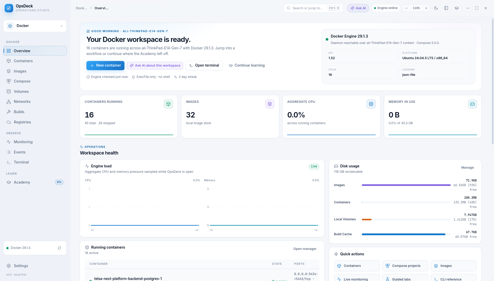
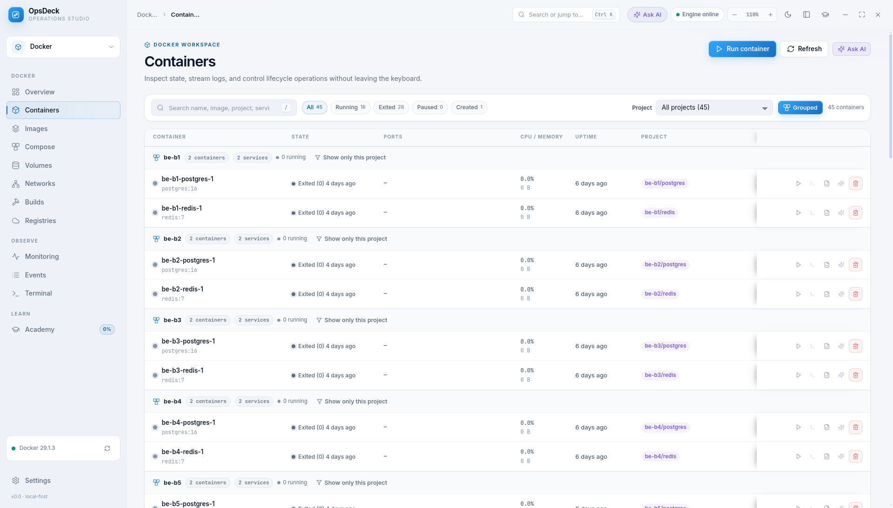
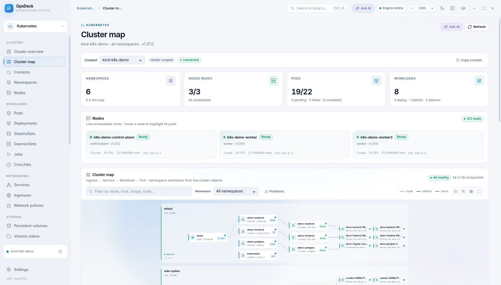
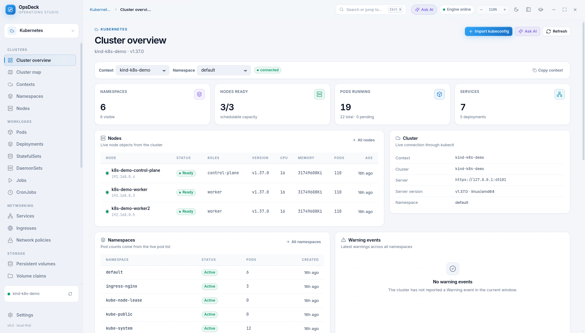
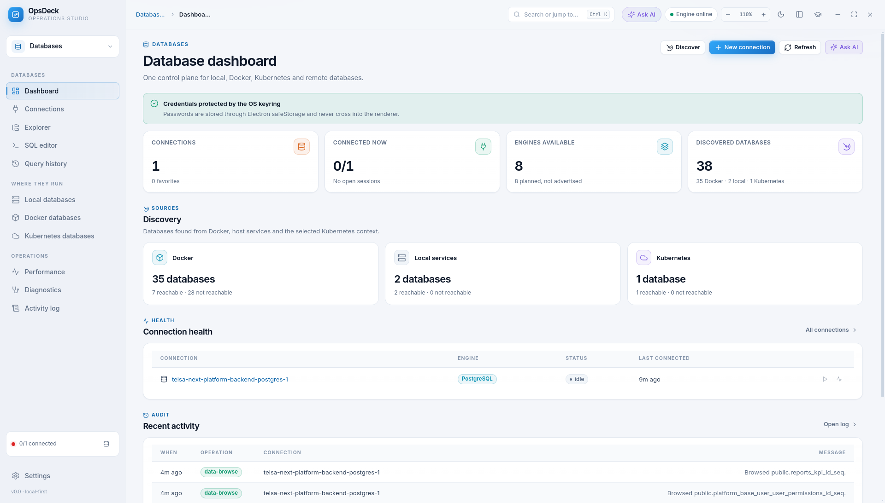
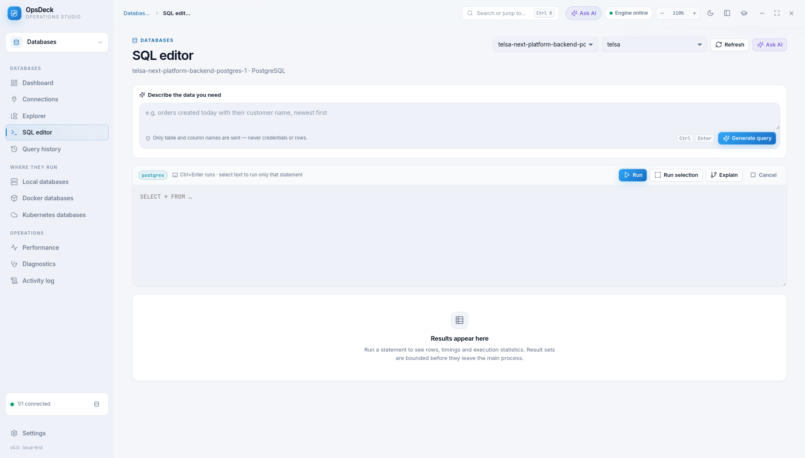
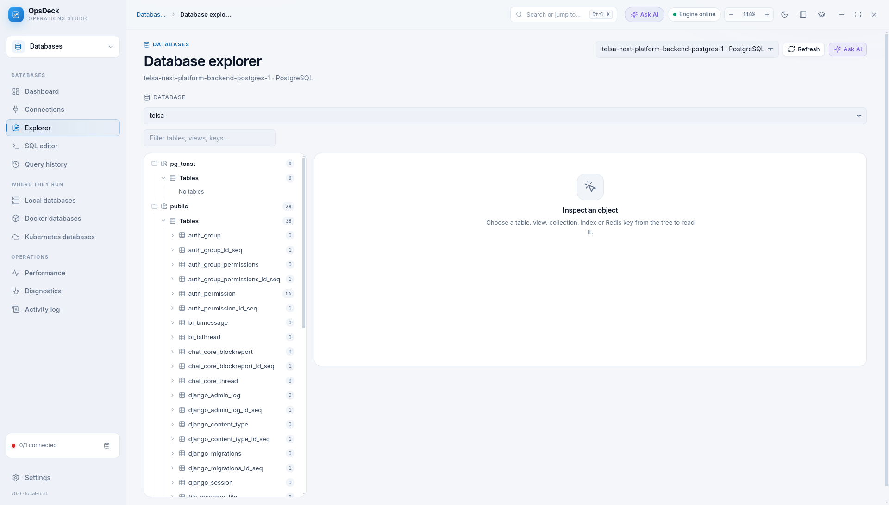
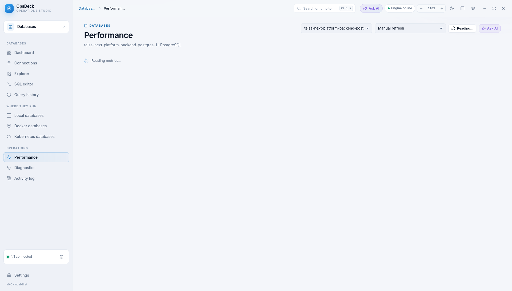

<div align="center">


# OpsDeck — Operations Studio

**One local-first desktop cockpit for Docker, Kubernetes and your databases —
with a full interactive Docker Academy and an AI assistant that sees what you see.**




</div>

Everything runs on your machine. No account, no telemetry, no network calls from the
renderer. Docker and kubectl commands go through `execFile` with argument arrays — never a shell.

## Highlights

| | |
|---|---|
| 🐳 **Docker** | Containers, images, volumes, networks, Compose, builds, live stats and a real in-app shell |
| ☸️ **Kubernetes** | Live cluster map, resources, pod logs and shells, kubectl console, Minikube controls |
| 🗄️ **Databases** | PostgreSQL, MySQL/MariaDB, SQLite, MongoDB, Redis and Elasticsearch in one workspace |
| 🎓 **Academy** | 18 courses, 70 lessons, 210 quiz questions, labs and a 119-entry command reference |
| ✨ **AI** | Context-aware assistant: bring any OpenAI-compatible API or a local CLI, keys never leave the main process |

## Screenshots

<table>
<tr>
<td><br /><sub><b>Containers</b> — state, ports, live CPU/memory, project grouping</sub></td>
<td><br /><sub><b>Cluster map</b> — Ingress → Service → Workload → Pod</sub></td>
</tr>
<tr>
<td><br /><sub><b>Kubernetes overview</b> — contexts, nodes and health</sub></td>
<td><br /><sub><b>Databases</b> — discovery and connections</sub></td>
</tr>
<tr>
<td><br /><sub><b>SQL editor</b> — autocomplete, read-only guard, AI query generator</sub></td>
<td><br /><sub><b>Explorer</b> — browse schemas, tables and rows</sub></td>
</tr>
<tr>
<td colspan="2"><br /><sub><b>Performance</b> — live diagnostics per connection</sub></td>
</tr>
</table>

## What is inside

**Docker workspace**

- Overview with engine health, live samples and reclaimable disk
- Containers: state, ports, CPU/memory, logs, inspect, start/stop/restart/remove, and a real
  interactive shell — a host PTY from util-linux `script` attached to `docker exec -it` and
  rendered with xterm.js, so Tab completion, history, colours and Ctrl+C work from inside the
  container (bash with automatic sh fallback; a line-mode fallback keeps working without `script`)
- The shell drawer goes fullscreen with one click (or `Esc` to leave), and supports
  `Ctrl/Cmd+Shift+C`/`V` copy and paste
- Project view for containers: filter by Compose project or group the table by project,
  with running/service counts on every group
- Open a container's published TCP address in Firefox straight from its row or inspect drawer
- Images, volumes and networks with search, filters and safe destructive actions
- Create and start a container from any image row, with the run dialog prefilled
- Jump from an image to the container list filtered by that image, with a removable filter
  chip and a back/forward-safe URL
- Free space review for non-system images older than 1 month, 3 months, 6 months or a year:
  candidates are listed with their size, and deletion is opt-in, per-image and irreversible.
  Official base OS/runtime images (ubuntu, alpine, node, python, postgres, nginx and similar) and
  any image referenced by a running or stopped container are always excluded, and
  `docker image rm` runs without `--force` as a final guard
- Compose projects: resolved config, logs and lifecycle controls
- Builds, registries, monitoring, event stream and a validated Docker terminal
  (safety consent is asked once and remembered across launches)
- Container logs open pinned to the newest line, with a Latest pill whenever you scroll back
- Settings for theme, interface scale, motion, transparency, daily goal and progress reset
- App-wide zoom from 50% to 250%: `Ctrl/Cmd +`, `Ctrl/Cmd −`, `Ctrl/Cmd 0`, `Ctrl/Cmd` + scroll,
  the topbar control, Settings or the command palette; the factor persists between launches

**Kubernetes workspace**

- Real `kubectl` contexts; OpsDeck never edits your kubeconfig and enforces the selected context on every action
- Cluster overview and an interactive **cluster map**: Ingress → Service → Workload → Pod in
  namespace swimlanes, with filters, a Problems view, zoom and fullscreen
- Nodes, namespaces, Pods, Deployments, StatefulSets, DaemonSets, Jobs, CronJobs, Services,
  Ingresses, Network policies, Persistent volumes and claims, each with live summaries, events,
  manifests, `describe` output and copyable command catalogs
- Pod logs and interactive PTY pod shells; a validated kubectl console; command output goes fullscreen
- Minikube start/stop controls and one-click install of the Kubernetes CLI tools
- Secret data is never shown in views, command output or AI context

**Databases workspace**

- Engines with real adapters (no mock data): PostgreSQL, MySQL/MariaDB, SQLite, MongoDB, Redis and
  Elasticsearch/OpenSearch. Engines without an adapter are marked planned and never shown as connectable
- Discovery across Docker, local services and Kubernetes. Unpublished Docker ports are reported
  honestly with an exact publish-port fix; Kubernetes targets use a controlled `kubectl port-forward`
- Connection manager, schema explorer, SQL editor with table/column autocomplete, query history,
  activity log, performance and diagnostics
- Per-statement read-only enforcement and confirmation for destructive statements
- Secrets are stored with Electron `safeStorage` or AES-256-GCM only
- AI query generator with Simple and Advanced SQL/Django variants, plus Ask AI across the workspace
  (RTL-aware answers) and readable connection errors

**Docker Academy**

- 18 courses and 70 lessons from beginner to advanced, including a dedicated Compose track
- 210 quiz questions with explanations, exercise prompts and lesson notes
- Interactive lessons: objectives, copyable code, callouts, tables, diagrams and knowledge checks
- Full command reference: 119 entries across Docker CLI, Compose CLI, Dockerfile instructions and Compose YAML properties, each with examples, expected output, mistakes and security notes — plus live flag help parsed from your installed CLI
- 12 troubleshooting guides with a paste-an-error pattern tester
- 9 interactive architecture, lifecycle, layer, network, storage and build diagrams
- 8 guided labs plus lesson-embedded labs with consent, validation and label-based Reset Lab
- 6 learning paths, global search, glossary, bookmarks, streaks and achievements

Progress, quiz scores, bookmarks, notes, settings and activity are stored locally in
SQLite (`~/.config/OpsDeck/academy.db` on Linux).

**OpsDeck AI**

- An assistant in a right-hand drawer, opened from the topbar, `Ctrl/Cmd+Shift+A`, the
  command palette, a page header, or the Ask AI button on any container, image, volume,
  network, Compose project, monitoring row, lesson or course
- Each question carries a live snapshot of the selected resource, not just the visible
  row: container inspect, recent logs, live stats, `docker top`, base image history and
  Compose siblings; image inspect, layer history, disk usage and the containers that use
  it; volume/network inspect plus attached containers; Compose config, services, stats and
  logs; Academy lesson or course content
- Configure any OpenAI-compatible chat-completions endpoint in Settings → AI assistant.
  Presets cover DeepSeek, OpenAI, OpenRouter, Ollama and LM Studio; local providers on
  `localhost`/`127.0.0.1` work without a key
- Or run a locally installed AI CLI instead: OpenCode and Claude Code are supported as
  transports, reuse the CLI's existing sign-in and model configuration, and never require
  OpsDeck to store an API key. Settings shows whether the CLI is installed and signed in
- Suggested questions, Markdown answers, a context preview with source character counts,
  copy and retry, cancellation, and a persistent provider status card
- The API key is stored in the main process only (`%APPDATA%`/`~/.config/OpsDeck/ai.json`,
  mode `0600` on POSIX) and is never sent to the renderer. Requests run in the main
  process, so the renderer CSP stays `connect-src 'none'`
- Context is capped, sensitive keys are omitted (not masked) before it leaves the machine:
  environment values, secrets, tokens, passwords, credentials, kubeconfig, auth plugins
  and Secret data are dropped. Live logs/labels/Compose files are treated as untrusted
  data in the system prompt. Nothing is sent until you press Send

## Requirements

- Node.js 20+ and npm
- Linux, macOS or Windows for development
- Docker Engine for the Docker workspace and labs; `kubectl` (installable from the app) for Kubernetes. The Academy content, reference,
  diagrams and guides work without Docker; live flag help and labs need the engine.

## Run from source

```bash
npm install
npm start          # normal launch
npm run dev        # development launch (DevTools enabled)
```

## Quality gates

```bash
npm run check      # syntax, content integrity, IPC bridge, CSP and security rules
npm test           # node:test suites for content, AI helpers and command validation
npm run smoke      # launches Electron, walks every route and tests the shell
```

The smoke test uses the real preload bridge and real IPC handlers. It exits non-zero
on any render, search, palette, theme, shell or AI failure. AI is exercised against a
throwaway OpenAI-compatible server on `127.0.0.1` with a separate
`ai-smoke.json` config; your real provider, key and config are never read or changed.
When another OpsDeck instance is running, pass an isolated profile:

```bash
npm run smoke -- --user-data-dir=/tmp/opsdeck-smoke
```

## Build and install as a desktop app (Linux)

```bash
npm run package          # electron-builder --dir + per-user desktop install
```

Or separately:

```bash
npm run pack             # writes release/linux-unpacked
npm run install:desktop  # copies the app and writes the launcher + icon
```

The installer writes:

- `~/.local/opt/opsdeck/` — the application
- `~/.local/share/applications/opsdeck.desktop` — the menu entry
- `~/.local/share/icons/hicolor/512x512/apps/opsdeck.png` — the icon

OpsDeck then appears in the application list. Launch it with `gtk-launch opsdeck`.
Remove it with `npm run uninstall:desktop`.

`npm run dist` produces an AppImage and a `.deb` in `release/` via the same
[`electron-builder.yml`](./electron-builder.yml) configuration.

### Sandbox

Chromium's setuid sandbox helper (`chrome-sandbox`) must be owned by `root` with
mode `4755`, which a per-user install cannot do. Ubuntu's AppArmor policy also
blocks the unprivileged user-namespace fallback for apps started from the
desktop shell, so the generated launcher passes `--no-sandbox`; otherwise
clicking the icon aborts with `FATAL:setuid_sandbox_host.cc(158)` or
`No usable sandbox!`.

Hardening is still possible:

```bash
sudo chown root:root ~/.local/opt/opsdeck/chrome-sandbox
sudo chmod 4755 ~/.local/opt/opsdeck/chrome-sandbox
```

The generated launcher checks the helper on every start: once it is
root-owned and setuid, `--no-sandbox` is no longer passed, and no reinstall is
needed. Reinstalling the app resets the helper, so repeat the two commands
afterwards if you want the sandbox back.

The rest of the security model does not depend on the Chromium sandbox:
`contextIsolation` is on, `nodeIntegration` is off, the renderer runs under a
strict CSP, all content is local, and Docker access goes through a validated
IPC bridge. Docker commands are spawned with argument arrays, never a host
shell; the interactive terminal is the one exception, and its wrapper is a
fixed `stty …; exec docker exec -it <validated id> <bash|sh>` string passed to
util-linux `script`.

## Architecture

```
main.js                 Electron window, splash, single-instance lock, IPC bridge
preload.js              contextBridge surface: window.opsdeck
src/main/docker.js      Docker CLI adapter (execFile only, cached reads)
src/main/kubernetes/    kubectl runner, resources, topology, pod shells, Minikube
src/main/databases/     adapters, discovery, vault, port-forward tunnels, store
src/main/exec.js        container shell sessions: PTY via `script`, line-mode fallback
src/main/security.js    tokenizer + command/compose validation
src/main/store.js       sql.js SQLite store for learning progress
src/main/content.js     loads the compiled Academy JSON
src/main/labs.js        lab sandbox, hardening, file workspace, reset
src/main/ai.js          AI config, provider calls and live context builders
src/main/ipc.js         IPC handlers
src/main/smoke.js       Electron route/interaction smoke test (mock AI provider)
src/renderer/           design system, shell, Docker views, Academy views, AI drawer
src/renderer/vendor/    vendored xterm.js + fit addon (MIT) for the container terminal
scripts/content/        authored Academy curriculum and reference sources
scripts/build-content.js validates and compiles sources into content/*.json
content/                runtime JSON (generated, committed)
```

The renderer uses classic deferred scripts attached to `window.OD` — no bundler, no
build step, no `file://` module CORS problems. A strict CSP allows only local scripts,
styles and fonts, and the renderer has no network access.

### Content pipeline

Edit files in `scripts/content/`, then run:

```bash
node scripts/build-content.js
```

The compiler validates duplicate IDs, missing lessons, prerequisites, quiz answers,
dependencies and references before writing `content/`. The runtime reads only the
compiled JSON, so content can be updated without touching application code.

### Lab safety model

- Explicit consent before the first command
- Allowlisted training images only
- One Docker command per step, no shell operators
- Blocked: privileged mode, host PID/IPC/network/user/UTS namespaces, device passthrough,
  added capabilities, host bind mounts and Docker socket mounts
- Hardened: CPU, memory and PID caps, `--rm` where appropriate
- Every resource carries `opsdeck.lab=1` and `opsdeck.lab.id=<lab>` so Reset Lab removes
  only that lab's containers, networks, volumes and files
- Compose files are validated before Compose reads them

The terminal and labs share the same validator. A command that fails validation never
reaches the Docker binary.

## Design

Dark-first with a designed light theme, custom tokens and components, Inter and
JetBrains Mono, a collapsible grouped sidebar, `Ctrl/Cmd+K` command palette,
`Ctrl/Cmd+B` sidebar toggle, `Ctrl/Cmd+Shift+F` Academy search,
`Ctrl/Cmd+Shift+A` AI assistant, app-wide zoom (`Ctrl/Cmd +`, `−`, `0`), keyboard
navigation and reduced-motion support.

## License

Private project. All rights reserved.
